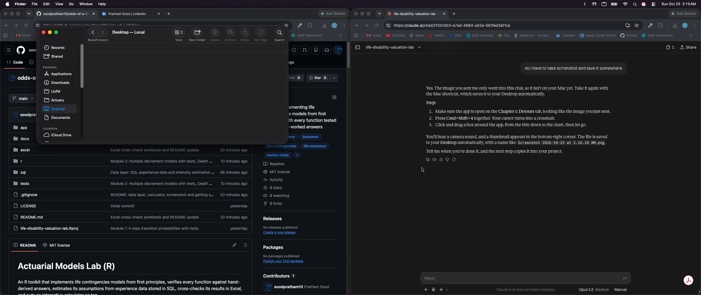
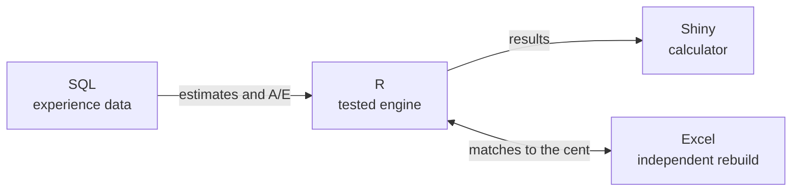

# The Odds of a Lifetime

*One policy, every way a life can unfold.*

      

**[▶ Try the live calculator](https://soodpratham10.shinyapps.io/odds-of-a-lifetime/)** (no installation needed)



## Prologue

Someone signs an insurance policy today. In return for a premium, an insurer makes a promise that may not be tested for decades.

Then life happens. They might fall ill and recover, or not. They might stop paying and walk away. They might share the promise with a partner, retire on it, or count on a guarantee buried in the fine print. Every one of those paths has odds, and every path costs something.

This project prices those odds. Each chapter takes one way a life can unfold and tells it the same way: build the actuarial model from first principles, check it against hand-derived answers, test it against experience data in SQL, rebuild it independently in Excel, and turn it into an interactive calculator. Together the chapters answer one question:

> Once a promise is sold, how much must the insurer hold to keep it, and why did the result differ from what was expected?

## The chapters

| Chapter | Title | The story | Actuarial model | Status |
|---|---|---|---|---|
| 1 | **Detours** | Life doesn't go in a straight line | Multiple state models (healthy, disabled, dead) | Done |
| 2 | **Exits** | Everyone leaves eventually, but how? | Multiple decrement models (death, lapse) | Done |
| 3 | **Two Lives** | A promise made to a couple | Multiple life models (joint life, last survivor) | Done |
| 4 | **The Long Wait** | Decades of saving for the years after work | Pension mathematics | Next |
| 5 | **The Reckoning** | Did the promise pay off for the insurer? | Profit testing and analysis of surplus | Planned |
| 6 | **Room to Move** | A promise that bends | Universal life | Planned |
| 7 | **The Fine Print** | Guarantees that cost more than they look | Embedded options | Planned |

## The toolkit, chapter by chapter

Every chapter uses all four tools, each with its own job.



| | R: the engine | SQL: where the odds come from | Excel: a second opinion | Shiny: the calculator |
|---|---|---|---|---|
| **1. Detours** | Kolmogorov equations, annuities, premiums | Transition intensities estimated from time spent in each state | Euler and closed-form rebuild, matches R to the cent | Disability & death tab |
| **2. Exits** | Decrement tables, UDD conversions, premiums | Death and lapse experience study, actual vs expected | Decrement table and premium rebuild, matches R to the cent | Death & lapse tab |
| **3. Two Lives** | Joint-life, last-survivor and reversionary annuities | Couples study: who is alive, and who died first | Life table and annuity rebuild, matches R and the SOA table | Couples tab |

---

## Chapter 1: Detours

*A healthy person may become disabled, and a disabled person may die. The policy pays an income while they are disabled and a lump sum on death, and premiums stop while they are not healthy.*

### What the engine does

- **Transition probabilities** for discrete-time Markov chains, homogeneous or not, with input validation
- **Kolmogorov's forward equations**, solved by Euler's method for any set of intensities, constant or varying with time
- **Annuities and insurances by state**: payments while in a state, or on entry into a state
- **Premiums** by the equivalence principle

### The mathematics

Notation follows Dickson, Hardy and Waters, *Actuarial Mathematics for Life Contingent Risks*.

The probability of being in state $j$ at age $x+t$, given state $i$ at age $x$, and the transition intensity from $i$ to $j$:

$$
{}_tp_x^{ij} = \Pr\big[\text{in state } j \text{ at age } x+t \mid \text{in state } i \text{ at age } x\big],
\qquad
\mu_x^{ij} = \lim_{h \to 0^+} \frac{{}_hp_x^{ij}}{h}
$$

Kolmogorov's forward equations: the probability of being in state $j$ grows with flow in and shrinks with flow out.

$$
\frac{d}{dt}{}_tp_x^{ij} = \sum_{k \neq j} \Big( {}_tp_x^{ik}\mu_{x+t}^{kj} - {}_tp_x^{ij}\mu_{x+t}^{jk} \Big)
$$

These are solved with Euler's method, using the generator matrix $\mathbf{Q}$ (intensities off the diagonal, minus the row sums on it):

$$
\mathbf{P}(t+h) \approx \mathbf{P}(t) + h\mathbf{P}(t)\mathbf{Q}(t)
$$

Annuity while in state $j$, and insurance on entry into state $j$, over $n$ years at force of interest $\delta$:

$$
\bar{a}_{x:\overline{n}|}^{ij} = \int_0^n e^{-\delta t} {}_tp_x^{ij} dt
$$

$$
\bar{A}_{x:\overline{n}|}^{ij} = \int_0^n e^{-\delta t} \sum_{k \neq j} {}_tp_x^{ik}\mu_{x+t}^{kj} dt
$$

Premium paid while healthy, for $D$ per year while disabled and $B$ on death:

$$
P = \frac{D\bar{a}_{x:\overline{n}|}^{01} + B\bar{A}_{x:\overline{n}|}^{02}}{\bar{a}_{x:\overline{n}|}^{00}}
$$

For constant intensities there are exact answers, which the tests and the Excel workbook compare against:

$$
{}_tp_x^{00} = e^{-(\mu^{01}+\mu^{02})t},
\qquad
{}_tp_x^{01} = \frac{\mu^{01}}{\mu^{12}-\mu^{01}-\mu^{02}}\Big(e^{-(\mu^{01}+\mu^{02})t} - e^{-\mu^{12}t}\Big)
$$

### Where the odds come from (SQL)

Synthetic policyholders are simulated moving between states and stored in SQLite as one row per spell (a stretch of time in one state). With $D^{ij}$ transitions from $i$ to $j$ and $T^{i}$ total years spent in state $i$:

$$
\hat{\mu}^{ij} = \frac{D^{ij}}{T^{i}},
\qquad
\text{Var}\big(\hat{\mu}^{ij}\big) \approx \frac{D^{ij}}{\big(T^{i}\big)^2}
$$

`sql/transitions.sql` counts the transitions and `sql/exposure.sql` sums the exposure. With 20,000 simulated lives observed for 5 years, every true value falls inside its 95% interval:

| Transition | True value | Estimate | 95% interval |
|---|---|---|---|
| Healthy to disabled | 0.10 | 0.1001 | 0.0977 to 0.1024 |
| Death while healthy | 0.05 | 0.0512 | 0.0495 to 0.0528 |
| Death while disabled | 0.20 | 0.2010 | 0.1937 to 0.2084 |

The calculator can load these estimates with one click.

### A second opinion (Excel)

`excel/disability_death_crosscheck.xlsx` rebuilds Chapter 1 in spreadsheet formulas only: an Euler sheet, a closed-form sheet, and an experience sheet that re-estimates the intensities from the SQL results. R and Excel agree to the cent, and both are within 0.03% of the exact answer (the gap is the Euler step error):

| | R | Excel (Euler) | Exact |
|---|---|---|---|
| Annual premium | $2,433.23 | $2,433.23 | $2,432.57 |
| EPV of disability benefit | $15,960.66 | $15,960.66 | $15,955.76 |
| EPV of death benefit | $8,313.12 | $8,313.12 | $8,312.26 |

---

## Chapter 2: Exits

*A term policy ends in one of three ways: the policyholder dies, walks away (lapses), or reaches the end of the term. How many leave each way, and when, changes the price.*

### What the engine does

- **Multiple decrement tables**: lives in force and exits by cause, year by year
- **Associated single decrement rates**: converting between independent and dependent rates under either uniform distribution assumption, for any number of decrements
- **Constant forces of decrement**
- **Benefits that depend on the cause of exit**, annuities and premiums

### The mathematics

Total exit probability, and the probability of staying in force for $k$ years:

$$
q^{(\tau)}_{x} = \sum_j q^{(j)}_{x},
\qquad
{}_kp^{(\tau)}_x = \prod_{r=0}^{k-1}\big(1 - q^{(\tau)}_{x+r}\big)
$$

If each decrement is uniformly distributed over the year in its own single decrement table, the dependent rates follow from the independent ones:

$$
q^{(j)}_x = q^{\prime(j)}_x \int_0^1 \prod_{k \neq j} \big(1 - tq^{\prime(k)}_x\big) dt
$$

which for two decrements is $q^{(1)} = q^{\prime(1)}\big(1 - \tfrac{1}{2}q^{\prime(2)}\big)$. If instead decrements are uniform in the multiple decrement table:

$$
p^{\prime(j)}_x = \big(p^{(\tau)}_x\big)^{q^{(j)}_x / q^{(\tau)}_x}
$$

Benefits $b^{(j)}$ paid at the end of the year of exit, and premiums paid at the start of each year while in force:

$$
\text{EPV} = \sum_{k=0}^{n-1} v^{k+1} {}_kp^{(\tau)}_x \sum_j b^{(j)} q^{(j)}_{x+k},
\qquad
\ddot{a} = \sum_{k=0}^{n-1} v^{k} {}_kp^{(\tau)}_x
$$

### What the calculator shows

A 20-year term policy with a $250,000 death benefit, mortality starting at 0.002 and rising 8% a year, lapses of 10% in year one and 5% after, and 5% interest:

| | Premium |
|---|---|
| Allowing for lapses | $816.86 |
| If nobody lapses | $953.62 |
| Effect of lapses | −14.3% |

Lapses remove people before they reach the expensive later years, so the expected lapses lower the premium. This is **lapse-supported pricing**, and it is a real risk: if fewer people lapse than assumed, the insurer has undercharged.

### Where the exits come from (SQL)

50,000 simulated policies are stored in SQLite, one row per policy with the year it ended and why. `sql/exit_study.sql` counts, for each policy year, the policies in force at the start and the deaths and lapses during the year. The estimated rates and the actual-to-expected ratio are

$$
\hat{q}^{(j)}_k = \frac{d^{(j)}_k}{l_k},
\qquad
\frac{A}{E} = \frac{\sum_k d^{(j)}_k}{\sum_k l_k q^{(j)}_k}
$$

Against the assumptions used to price the policy:

| Decrement | Actual | Expected | A/E |
|---|---|---|---|
| Death | 2,277 | 2,310 | 98.6% |
| Lapse | 31,970 | 32,259 | 99.1% |

The calculator recomputes A/E live as the assumption sliders move, and plots the observed lapse rate in each policy year against the assumption, so a mis-set assumption shows up straight away.

### A second opinion (Excel)

`excel/exits_crosscheck.xlsx` rebuilds the decrement table and both premiums in spreadsheet formulas, and re-runs the experience study from the SQL results. It matches R to the cent ($816.86, $953.62, $6,935.63, annuity factor 8.4906) and gives the same A/E ratios.

### The two chapters are one model

A multiple decrement model is a multiple state model with one starting state. A test checks this directly: the Chapter 1 Kolmogorov solver, applied to a model with states *in force*, *dead* and *lapsed*, reproduces the Chapter 2 decrement probabilities.

---

## Chapter 3: Two Lives

*A couple retires on a promise: an income while both are alive, and part of it for whoever survives. How long each lives, and which one goes first, sets the cost.*

### What the engine does

- **Joint-life and last-survivor statuses**: survival, annuities and insurances on the first and second death
- **Reversionary annuities**: income to one life only after the other has died
- **Contingent probabilities**: the chance that one life dies before the other
- **Expected time to first and last death** under constant forces
- **Makeham mortality** with the parameters of the SOA Standard Ultimate Life Table

### The mathematics

For independent lives, the joint-life status survives while both are alive, and the last-survivor status while at least one is:

$$
{}_kp_{xy} = {}_kp_x \cdot {}_kp_y,
\qquad
{}_kp_{\overline{xy}} = {}_kp_x + {}_kp_y - {}_kp_{xy}
$$

Annuities paid at the start of each year while the status survives satisfy

$$
\ddot{a}_{xy} + \ddot{a}_{\overline{xy}} = \ddot{a}_x + \ddot{a}_y
$$

An income to $(y)$ only after $(x)$ has died is a reversionary annuity:

$$
\ddot{a}_{x|y} = \ddot{a}_y - \ddot{a}_{xy}
$$

A joint and survivor pension pays $A$ while both are alive and a share $s$ of it to the survivor:

$$
\text{EPV} = A\big(s \ddot{a}_{\overline{xy}} + (1-s) \ddot{a}_{xy}\big)
$$

The probability that $(x)$ dies before $(y)$ within $n$ years, with deaths uniformly distributed over each year of age:

$$
{}_nq_{\overset{1}{x}y} = \sum_{k=0}^{n-1} {}_kp_{xy} q_{x+k}\Big(1 - \tfrac{1}{2}q_{y+k}\Big)
$$

Mortality follows Makeham's law, $\mu_x = A + Bc^x$, with $A = 0.00022$, $B = 2.7 \times 10^{-6}$ and $c = 1.124$.

### What the calculator shows

A couple aged 65 and 62, an income of $20,000 a year, 60% to the survivor, and 5% interest:

| | Cost today |
|---|---|
| Joint and survivor pension (60%) | $286,717 |
| Income continues in full to the survivor | $316,151 |
| Income stops at the first death | $242,566 |
| Income to the younger life only after the older one dies | $45,155 |

The probability that the 65-year-old dies first is 58.6%. The single-life annuity factor at age 65 is 13.5498, which matches the published SOA Standard Ultimate Life Table value at 5%.

### Who is still here (SQL)

20,000 simulated couples aged 65 and 62 are followed for 30 years and stored in SQLite, one row per couple with the time each partner died. `sql/couple_study.sql` counts, for each year, the couples with both partners alive, the couples with at least one alive, and which partner died first. The data tracks the model closely:

| Measure | Observed | Model |
|---|---|---|
| Both alive after 10 years | 83.6% | 83.6% |
| Both alive after 20 years | 47.3% | 47.5% |
| At least one alive after 20 years | 90.6% | 90.6% |
| At least one alive after 29 years | 55.4% | 55.3% |
| The 65-year-old dies first within 30 years | 53.7% | 54.0% |

### A second opinion (Excel)

`excel/two_lives_crosscheck.xlsx` builds the couple's life table from the Makeham formula in spreadsheet cells, then the joint-life, last-survivor and reversionary annuities. It matches R to the cent for every cost and to four decimals for every annuity factor, reproduces the SOA table value of 13.5498 at age 65, and re-runs the couples study from the SQL results.

### Three chapters, one model

Two lives are also a multiple state model, with states *both alive*, *only one alive* and *both dead*. A test checks that the Chapter 1 Kolmogorov solver reproduces the joint-life and last-survivor probabilities.

---

## How correctness is checked

1. **Automated tests** (`tests/`, 89 checks): expected values worked out by hand or derived as closed-form formulas before the code is written, including the SQL queries on small hand-built databases
2. **Experience data** (`sql/`): every chapter's model is tested against simulated experience, and the data recovers the assumptions
3. **Excel rebuilds** (`excel/`): every chapter's calculations implemented separately in spreadsheet formulas, matching R to the cent
4. **Exact answers and published tables**: numerical results compared with closed forms and the SOA Standard Ultimate Life Table

## A note on assumptions

The rates in the examples, tests, workbooks and calculator are illustrative, and the experience data is simulated. They are **not calibrated to real data** and are not a pricing basis.

## Getting started

```r
install.packages(c("testthat", "DBI", "RSQLite", "shiny"))

# Run the tests
testthat::test_file("tests/test_multistate.R")
testthat::test_file("tests/test_experience.R")
testthat::test_file("tests/test_decrement.R")
testthat::test_file("tests/test_multilife.R")

# Build the experience database (the file is not stored in the repository)
source("r/multistate.R"); source("r/decrement.R")
source("r/multilife.R"); source("r/experience.R")
db <- "sql/experience.sqlite"

# Chapter 1: lives moving between healthy, disabled and dead
mu_true <- matrix(c(0, 0.10, 0.05,
                    0, 0,    0.20,
                    0, 0,    0), nrow = 3, byrow = TRUE)
spells <- simulate_experience(mu_true, n = 20000, obs_years = 5, seed = 2026)
DBI::dbDisconnect(write_experience_db(spells, db))

# Chapter 2: term policies that die or lapse
k <- 0:19
q_true <- udd_single_to_multiple(cbind(0.002 * 1.08^k, ifelse(k == 0, 0.10, 0.05)))
DBI::dbDisconnect(write_policy_db(simulate_policies(q_true, n = 50000, seed = 2026), db))

# Chapter 3: couples aged 65 and 62
qx <- makeham_q(65, 30); qy <- makeham_q(62, 30)
couples <- simulate_couples(qx, qy, n = 20000, seed = 2026, age_x = 65, age_y = 62)
DBI::dbDisconnect(write_couple_db(couples, db))

# Open the calculator
shiny::runApp("app")
```

## How the pieces map to code

| Chapter | Engine | Experience data | Excel |
|---|---|---|---|
| 1. Detours | `r/multistate.R`: `kolmogorov_path()`, `epv_annuity()`, `epv_insurance()`, `equivalence_premium()` | `r/experience.R`, `sql/schema.sql`, `sql/exposure.sql`, `sql/transitions.sql`: `simulate_experience()`, `estimate_intensities()` | `excel/disability_death_crosscheck.xlsx` |
| 2. Exits | `r/decrement.R`: `decrement_table()`, `udd_single_to_multiple()`, `udd_multiple_to_single()`, `md_premium()` | `r/experience.R`, `sql/policy_schema.sql`, `sql/exit_study.sql`: `simulate_policies()`, `estimate_decrement_rates()`, `actual_vs_expected()` | `excel/exits_crosscheck.xlsx` |
| 3. Two Lives | `r/multilife.R`: `joint_annuity()`, `last_survivor_annuity()`, `reversionary_annuity()`, `contingent_first()`, `makeham_q()` | `r/experience.R`, `sql/couple_schema.sql`, `sql/couple_study.sql`: `simulate_couples()`, `compare_couples()` | `excel/two_lives_crosscheck.xlsx` |

## Repository layout

```
r/          the engine, one file per chapter, plus the experience-data functions
sql/        database schemas and experience-study queries
excel/      one independent cross-check workbook per chapter
tests/      automated tests with hand-checked expected values
app/        the calculator
docs/       images and write-ups
```

## About

Built alongside my actuarial coursework at the University of Manitoba. Course notes and exam material are not included in this repository.

License: MIT